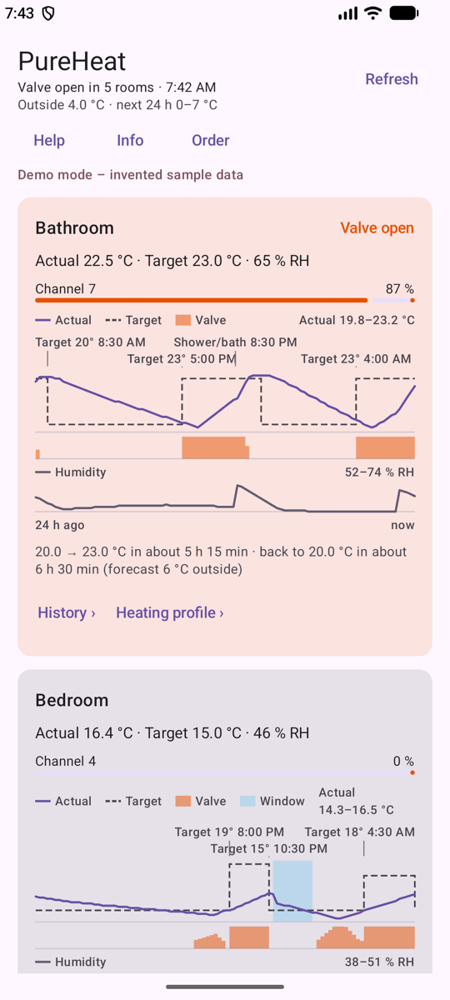
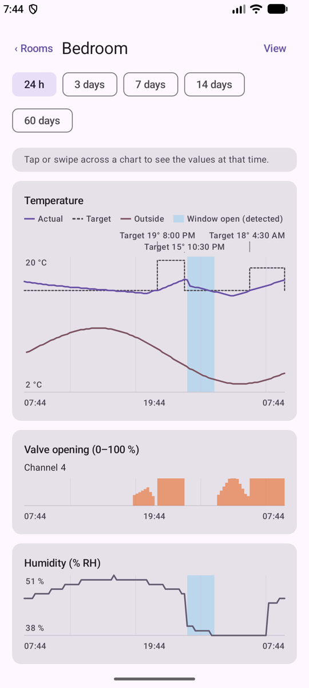
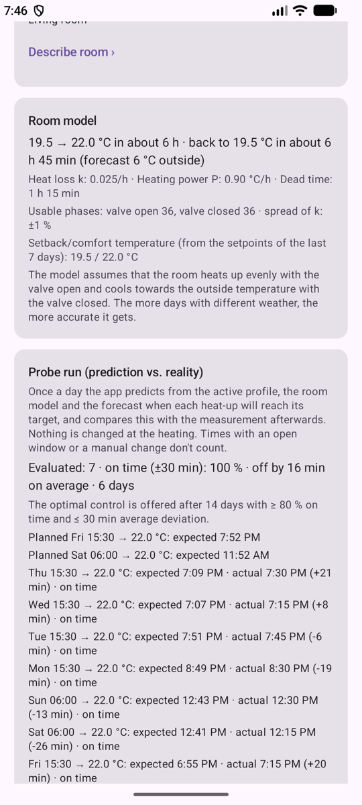
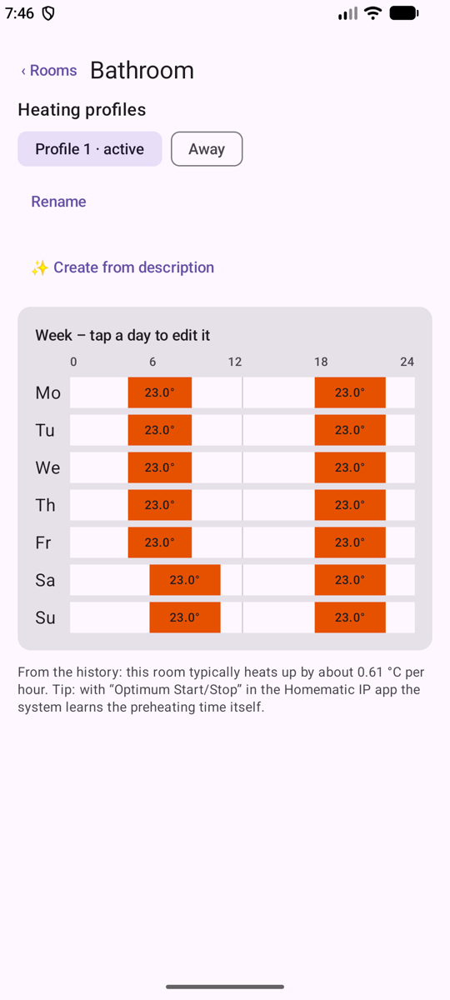

  

<h1 align="center">PureHeat</h1>

  <b>English</b> · <a href="README.de.md">Deutsch</a>

  <b>See what your floor heating is really doing.</b> 
  Android app for Homematic IP floor heating – shows what the official app doesn't,
  and learns how each room behaves.

  
  
  
  
  

  

---

|  |  |  |  |
|:-:|:-:|:-:|:-:|
| Which circuit is heating | Detected open window | Learned room model and probe run | Heating profiles |

Screenshots from the built-in demo mode with invented data.

## Why PureHeat?

The official app shows target and current temperature – but not **what is happening at the heating
manifold**. With floor heating in a slow-reacting screed, that is exactly what matters: Which circuit
is heating right now? How far is the valve open? How long does the bathroom take to warm up in the
morning? PureHeat answers these questions from the data your system already provides.

## Features

### 🔥 Heating circuits at a glance
- See instantly **which heating circuit is open** and how far each valve actuator is open.
- Warning when a valve has been open for a long time but the room is not getting warmer – e.g. a
  stuck valve pin.
- Current and target temperature, humidity, outdoor temperature and weather forecast.

### 📈 History
- Recorded in the background (every 15–60 minutes, battery-friendly) and kept for **2 years**.
- Detail view per room for up to 60 days with temperature, valve opening and events.
- Export and import of measurements and settings.

### 🧠 Learning room model
- A physical model for every room: **heat loss**, **heating power** and **dead time** of the screed.
- From that, heat-up and cool-down times: "How long does it take from 19 to 22 °C?"
- A **probe run** checks the predictions against reality every day – so you see how good the model
  really is.

### 🪟 Event detection
- **Open windows** and **showering/bathing** are detected from temperature and humidity.
- Describe **room properties** by text or dictation ("bathroom with shower, no window") – evaluated
  by AI **on the device** (Gemini Nano), no cloud. The description sharpens the detection.

### 🗓️ Convenient heating profile editing
- Edit, rename, activate and undo profiles.
- Get a heating profile suggestion from a description in your own words.
- Before every save a **list of changes** and a confirmation, a **backup** beforehand, and a
  **read-back check** afterwards that the cloud applied everything correctly.

### 🌍 And also
- 12 languages (English, German, French, Spanish, Italian, Portuguese, Dutch, Polish, Turkish,
  Russian, Japanese, Chinese).
- Detailed help right in the app.

## Privacy and safety

### What is recorded

PureHeat stores only what it needs for the history and the room model, in a database **on your
device**:

| Data | Purpose |
|---|---|
| Current and target temperature, humidity and valve opening per room | History, room model, window and shower detection |
| Valve opening per heating circuit | Which circuit is heating, valve warnings |
| Outdoor temperature and hourly forecast | Heat loss in the model, heat-up predictions |
| Predictions of the probe run and their results | Checking how good the model is |
| Your room descriptions and view settings | Detection rules, layout |

The history is kept for 2 years (about 120 KB per day, roughly 90 MB after 2 years) and is deleted
automatically after that. Export and import only happen when you trigger them.

### Why your data is safe

- **No ads, no tracking, no analytics, no own server** – there is no PureHeat backend that could
  collect anything.
- **Only one permission: internet.** No access to GPS, contacts, camera or files.
- The auth token and all measurements stay in the app's private storage; Android backup is
  switched off, so nothing ends up in a cloud backup.
- Data goes only to the Homematic IP Cloud (which your system uses anyway) and to
  [Open-Meteo](https://open-meteo.com) for the weather forecast – with the home location rounded to
  ~1 km and without any identifier.
- AI runs **on the device** (Gemini Nano); room descriptions never leave the phone.
- **Writes only for heating profiles**, and only after your confirmation. PureHeat never sets
  temperatures on its own; the AI only makes suggestions.
- Open source: you can check all of this in the code.
- Details: [Privacy policy](docs/privacy.md#english)

## Requirements

- Homematic IP with Access Point **HmIP-HAP** and cloud connection
- Floor heating actuator (e.g. HmIP-FAL) with wall thermostats
- Android 8.0 or newer; for the AI features a device with Gemini Nano (otherwise keyword detection)

## Setup

1. Build and install the app: `./gradlew installDebug`
2. Enter the SGTIN of the Access Point in the app (printed on the sticker under the device).
3. When the app asks for it, press the blue button on the Access Point.

Done – from now on PureHeat records in the background and the room model learns more every day.

**No access point at hand?** Tap **“Try demo mode”** on the setup screen: a sample flat with three
weeks of invented history, a learned room model, an aired bedroom and showers in the bathroom. It
works offline, sends nothing anywhere and is left via “Log out”.

### Battery setting for a complete history

Android slows down background jobs of apps that are rarely opened – on the real system this left
gaps of up to 9 hours. For continuous measurements set **App info → Battery → “Unrestricted”**
(as long as the app is restricted, it shows a hint card with a direct link to this setting).

The battery drain stays minimal anyway:

- PureHeat only fetches the state every **15 minutes** while something is changing, otherwise every
  30 minutes and every 60 minutes at night – one short request each time, about 100 KB.
- No permanent connection, no foreground service, no GPS. The jobs run via Android's WorkManager,
  which bundles them with other apps' work, and they pause when the battery is low.

> **Note:** Unofficial project, not affiliated with eQ-3. The cloud API is not officially documented
> and may change.

## Support

PureHeat is and will stay free, without ads and without tracking. If you like the app, you can
support its development voluntarily:

- 💙 [PayPal](https://paypal.me/ChristianPlagens)

A ⭐ for the repository, bug reports and suggestions help too – see
[CONTRIBUTING.md](CONTRIBUTING.md).

## Documentation

| File | Content |
|---|---|
| [ReleaseNotes.md](ReleaseNotes.md) | What changed in which version |
| [CONTRIBUTING.md](CONTRIBUTING.md) | Reporting bugs, building, testing, contribution rules |
| [LICENSE.md](LICENSE.md) | Apache License 2.0 |
| [NOTICE](NOTICE) | Copyright and notices |
| [docs/privacy.md](docs/privacy.md#english) | Privacy policy |
| [docs/ARCHITECTURE.md](docs/ARCHITECTURE.md) | Structure, data flow, database, API quirks |
| [docs/FINDINGS.md](docs/FINDINGS.md) | Findings on the real system |
| [docs/NEXT_STEPS.md](docs/NEXT_STEPS.md) | Roadmap |
| [docs/STATUS.md](docs/STATUS.md) | Current development status |

German versions: [README.de.md](README.de.md) and the matching `*.de.md` files; the privacy policy
contains both languages.

## License

Copyright 2026 Christian Plagens. Released under the [Apache License 2.0](LICENSE.md).

"Homematic IP" is a trademark of eQ-3 AG. PureHeat is an independent project.
